# Academia Newton · Propuesta de plataforma académica

Prototipo de portafolio desarrollado con **Laravel 12, Blade y Bootstrap 5** a partir de una propuesta para una academia preuniversitaria que no llegó a producción.

La propuesta reúne una portada institucional, acceso autenticado y navegación según el rol del usuario. Documenta cómo se podrían integrar la atención al estudiante y los procesos académicos y administrativos.

**Estado:** propuesta demostrable en local. **Presentación:** capturas y documentación en este repositorio. **Sin despliegue público.**

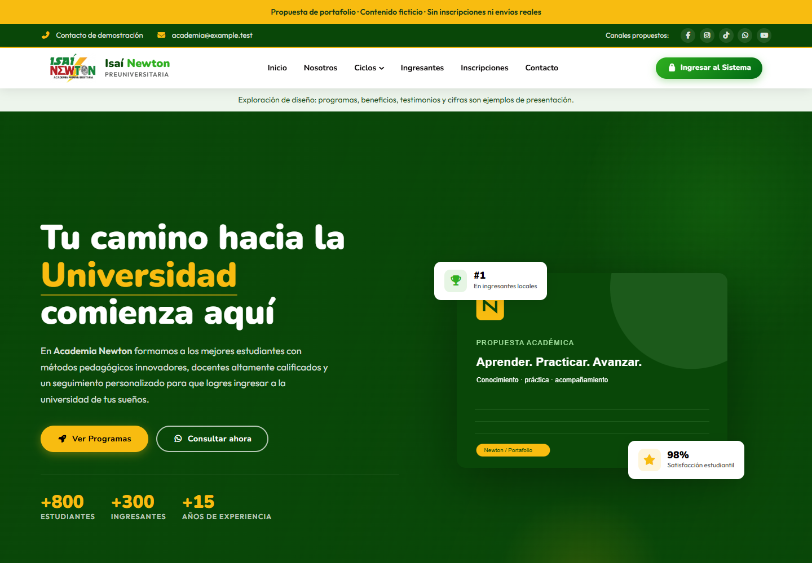

## Contexto y objetivo

El objetivo era centralizar información que normalmente se distribuye entre hojas de cálculo, mensajes y registros independientes: estudiantes, docentes, horarios, asistencias, matrículas y obligaciones de pago.

El trabajo llegó a una base de aplicación y una exploración visual. Este repositorio conserva ese alcance de forma explícita: muestra tanto lo implementado como los flujos que se plantearon para una siguiente etapa.

## Qué funciona y qué está propuesto

| Área | Estado en esta versión |
| --- | --- |
| Portada institucional | Implementada, adaptable a escritorio y móvil |
| Acceso y cierre de sesión | Implementados con validación y regeneración de sesión |
| Selección y cambio de rol | Implementados para cuentas con varios roles |
| Permisos por módulo | Implementados en servidor y menú; pertenencia al rol verificada en cada petición |
| Protección del login | Límite por correo/IP y límite adicional por IP |
| Cuentas ficticias | Comando local con contraseña aleatoria; bloqueado fuera de local/testing |
| Formulario de contacto | Simulación en el navegador: valida campos y muestra confirmación; no envía ni guarda datos |
| Alumnos, profesores, matrículas y deudas | Pantallas que explican el flujo previsto; sin CRUD ni persistencia de datos académicos |
| Asistencias, horarios y notificaciones | Pantallas de alcance funcional; sin registros, consultas reales ni envíos |
| Pagos, reportes e integraciones | Fuera del alcance implementado |

Los nombres, perfiles, resultados, cifras y testimonios de la portada son **contenido ficticio o ilustrativo**. El formulario no está conectado a correo, WhatsApp ni servicios externos. No se incluyen fotografías identificables de estudiantes.

## Recorrido visual

### Portada y programas

La portada presenta la identidad de la propuesta, sus programas y el recorrido hacia la sección de contacto. La versión completa permite revisar todas las secciones sin instalar el proyecto.

<details>
<summary>Ver la portada completa</summary>

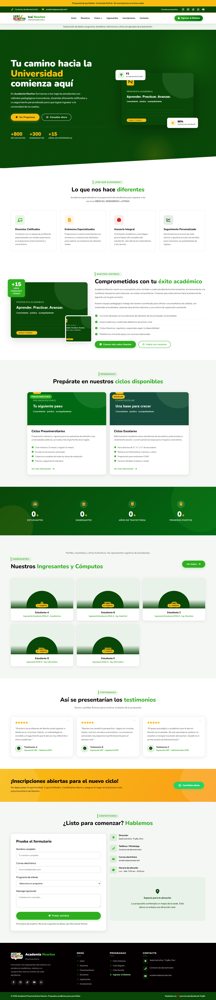

</details>

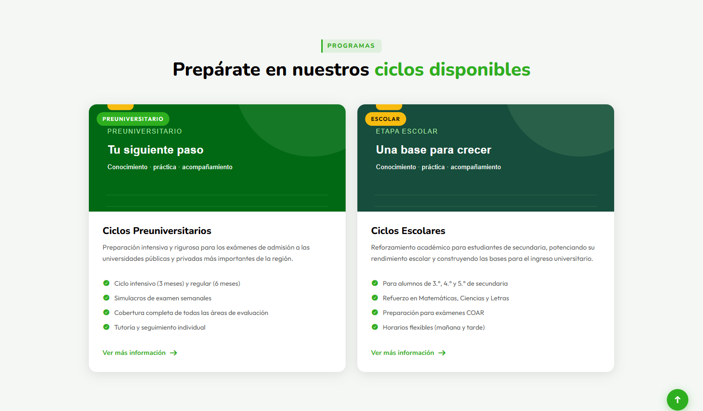

Los ciclos preuniversitarios y escolares se presentan como alternativas diferenciadas. Los beneficios y textos muestran la estructura comercial prevista, sin representar servicios activos ni resultados verificados.

### Contacto de demostración

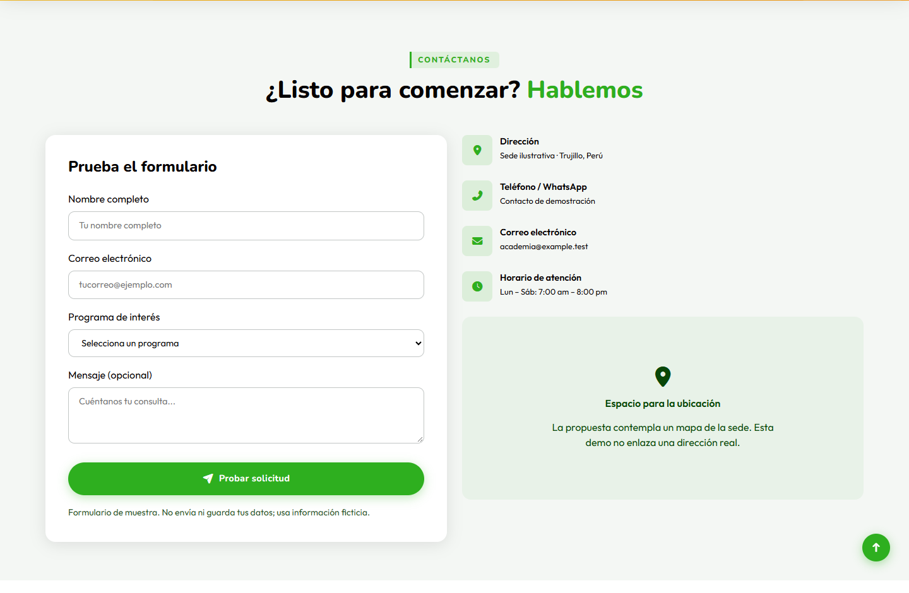

El visitante puede probar la validación del formulario con información ficticia. Al confirmar, la interfaz indica expresamente que no envió ni almacenó datos. Los enlaces de contacto conducen a esta sección y no a personas o cuentas reales.

### Autenticación

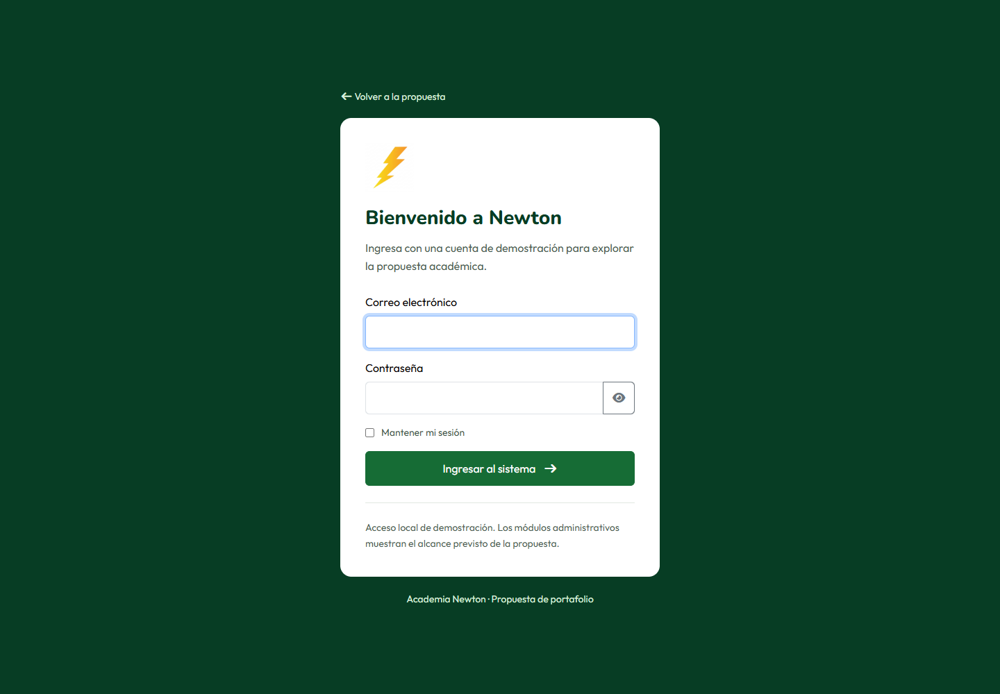

El acceso utiliza autenticación de Laravel, contraseñas con hash, protección CSRF y regeneración de sesión. Los errores se muestran dentro del formulario; los intentos repetidos reciben una respuesta 429.

### Selección de rol

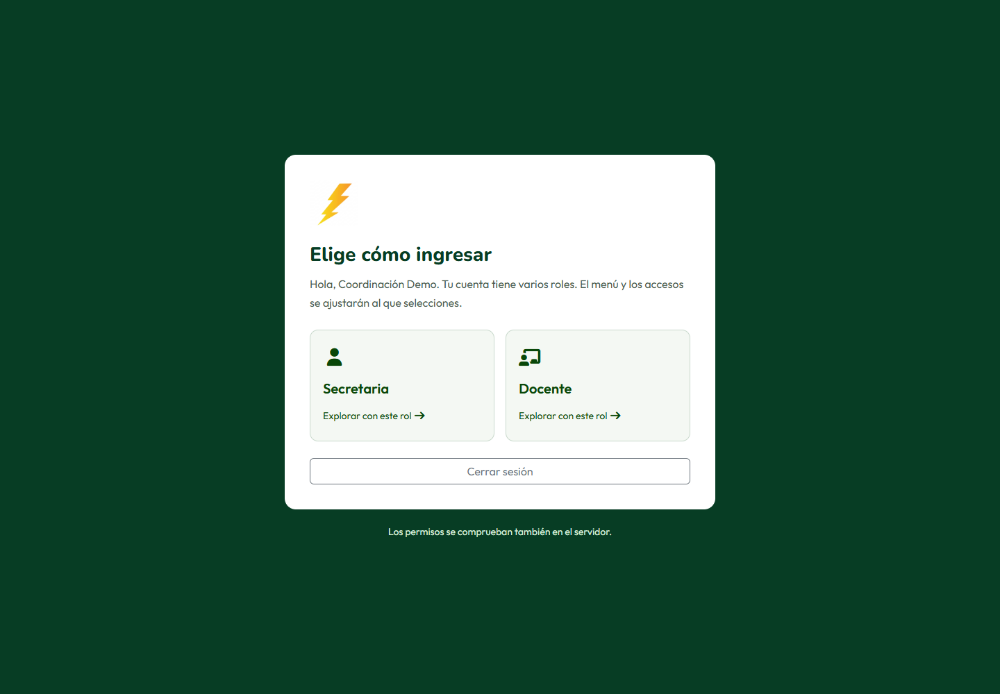

Una cuenta puede desempeñar más de un rol. La selección determina el menú y las pantallas autorizadas. El servidor solo acepta roles que pertenecen a la cuenta; cambiar la URL o enviar otro identificador no otorga permisos.

### Panel de dirección

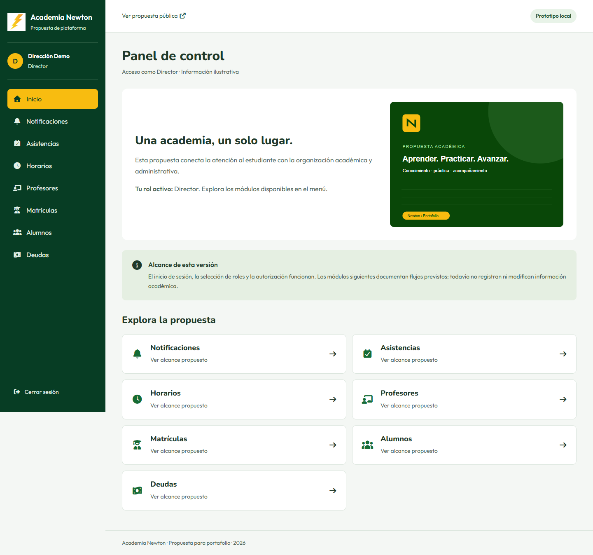

El panel reúne los módulos disponibles y aclara su estado. La dirección y la secretaría pueden explorar todos los flujos administrativos propuestos.

### Alcance de un módulo

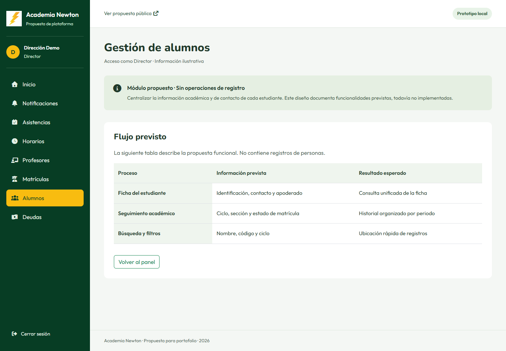

Cada pantalla explica procesos, información prevista y resultados esperados. Por ejemplo, alumnos plantea una ficha unificada, seguimiento por periodo y filtros de búsqueda. Estas tablas documentan la propuesta: **no son registros de una academia real ni operaciones terminadas**.

### Vista de estudiante y permisos

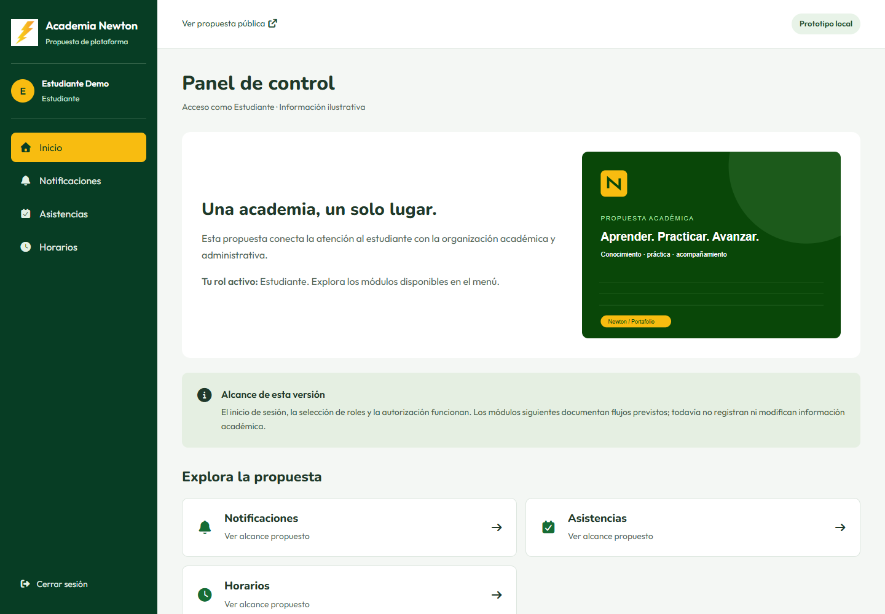

El estudiante ve únicamente notificaciones, asistencias y horarios. La autorización se ejecuta también en el servidor.

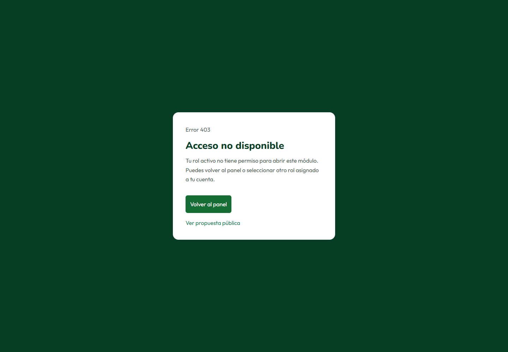

Una petición directa a un módulo restringido devuelve 403 con una salida clara al panel. Si se revoca el rol, el acceso se vuelve a comprobar; una cuenta sin roles cierra sesión en lugar de entrar en un bucle de redirecciones.

### Adaptación móvil

<table>
<tr><th>Portada</th><th>Acceso</th></tr>
<tr><td>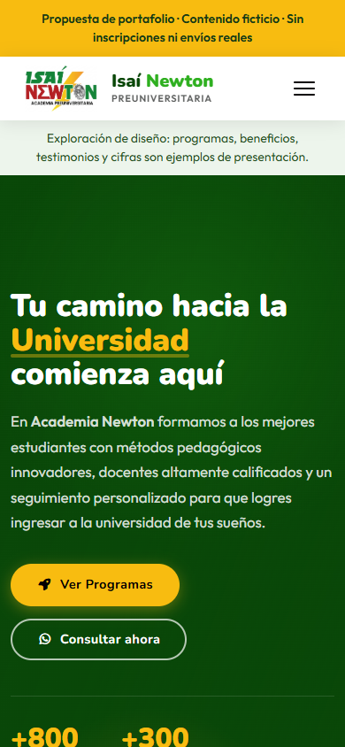</td><td>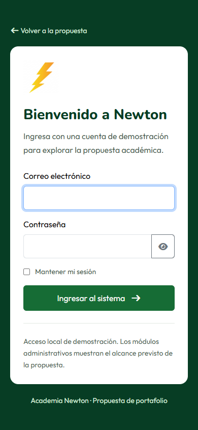</td></tr>
</table>

La navegación pública se adapta a un menú móvil. Los formularios mantienen campos legibles, y el panel dispone de navegación lateral plegable.

## Roles y acceso a pantallas

| Pantalla | Dirección | Secretaría | Docente | Estudiante |
| --- | :---: | :---: | :---: | :---: |
| Panel de inicio | Sí | Sí | Sí | Sí |
| Notificaciones | Sí | Sí | Sí | Sí |
| Asistencias | Sí | Sí | Sí | Sí |
| Horarios | Sí | Sí | Sí | Sí |
| Alumnos | Sí | Sí | Sí | — |
| Profesores | Sí | Sí | — | — |
| Matrículas | Sí | Sí | — | — |
| Deudas | Sí | Sí | — | — |

Esta matriz protege las pantallas de la propuesta. La autorización por registro —por ejemplo, que un alumno consulte únicamente sus propias asistencias— correspondería a la implementación futura de los módulos y todavía no existe.

## Base técnica

- **Servidor:** PHP 8.2+, Laravel 12, Eloquent y sesiones.
- **Interfaz:** Blade, Bootstrap 5 y JavaScript; recursos compilados con Vite.
- **Persistencia implementada:** usuarios, roles, relación usuario/rol e infraestructura de sesiones, caché y colas.
- **Base para reproducción local:** SQLite; la configuración también conserva soporte de otras conexiones de Laravel.
- **Recursos:** tipografías e iconos empaquetados localmente; sin scripts, mapas o fuentes cargados desde CDNs.
- **Verificación:** PHPUnit, Laravel Pint, auditorías de dependencias y capturas automatizadas con Playwright.

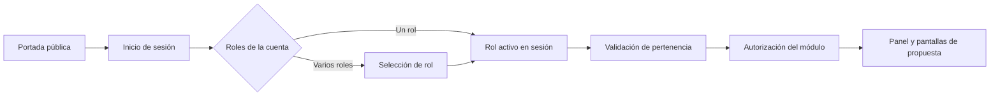

La sesión guarda el identificador del rol, no un objeto serializado usado como fuente de permisos. La configuración de módulos y sus accesos se encuentra en `config/academy.php`. La configuración base está publicada en `config/` para conservar compatibilidad con PHP 8.2 sin modificar `vendor`.

## Reproducir en local

Las capturas permiten evaluar la propuesta sin ejecutarla. Para explorar sus interacciones, utiliza una copia nueva del repositorio.

### Requisitos

- PHP 8.2 o superior, Composer 2 y extensiones habituales de Laravel, incluyendo `pdo_sqlite`, `sqlite3`, `mbstring`, `openssl`, `xml`, `fileinfo` y `curl`.
- Node.js 22.12+ o 24 y npm. La verificación local se realizó con Node.js 24 y PHP 8.2.

### Instalación

```bash
git clone https://github.com/Yanxmarcos/sistema-academia.git
cd sistema-academia
composer run setup
php artisan demo:seed
php artisan serve
```

`setup` instala dependencias, copia `.env.example` únicamente si no existe `.env`, genera la clave local, crea el archivo SQLite, ejecuta migraciones y compila recursos. `demo:seed` crea o restablece las seis cuentas ficticias y **muestra una contraseña aleatoria en tu terminal**. No hay una contraseña pública compartida.

Abre `http://127.0.0.1:8000`. La configuración de ejemplo usa `APP_ENV=local`, `DEMO_MODE=true` y SQLite. Si ya tienes un `.env` propio, el instalador lo conserva: revisa sus conexiones antes de ejecutar comandos de base de datos.

| Cuenta ficticia | Roles |
| --- | --- |
| `director@example.test` | Dirección |
| `secretaria@example.test` | Secretaría |
| `docente@example.test` | Docente |
| `estudiante@example.test` | Estudiante |
| `multirrol@example.test` | Secretaría y docente |
| `ayudante@example.test` | Secretaría y estudiante |

El comando solo admite los entornos `local` y `testing`, con `DEMO_MODE=true`. Cada ejecución restablece las cuentas anteriores. Opcionalmente puedes definir una contraseña de al menos 12 caracteres en `DEMO_PASSWORD`, dentro de tu `.env` ignorado. Para editar recursos con recarga, ejecuta `npm run dev` en otra terminal.

## Verificación y capturas

```bash
php vendor/phpunit/phpunit/phpunit
php vendor/bin/pint --test
composer validate --strict --no-check-publish
composer audit --locked
npm ci
npm run build
npm audit
```

Las pruebas cubren inicio y cierre de sesión, acceso de visitantes, selección de roles, matriz de permisos, revocación, cuentas sin roles, límites de login y protección de los seeders. Usan SQLite en memoria y no tu base local. GitHub Actions repite las comprobaciones al recibir cambios o propuestas de cambio.

Para regenerar las capturas:

```bash
npm run build
npm run screenshots
```

En Windows se utiliza Edge instalado. En otros sistemas, instala Chromium con `npx playwright install chromium`. Puedes seleccionar otro navegador compatible con `PLAYWRIGHT_CHANNEL=chrome` o `PLAYWRIGHT_CHANNEL=chromium` y cambiar el puerto con `SCREENSHOT_PORT`. En PowerShell, define estas variables con `$env:PLAYWRIGHT_CHANNEL = 'chrome'`.

El script crea una base SQLite temporal separada, genera credenciales efímeras y verifica escritorio, móvil, login, selección de roles, denegación de acceso y formulario de muestra. Después cierra el servidor y elimina exclusivamente su base temporal. Las capturas se guardan en `docs/screenshots/` y no contienen contraseñas ni datos personales reales.

## Evolución prevista

Para convertir esta propuesta en un sistema operativo habría que diseñar y desarrollar el modelo académico, los CRUD, reglas de matrícula, registros de asistencia, restricciones por registro, cronogramas de pago, reportes, notificaciones y pruebas de esos procesos. Las tablas de cada módulo sirven como punto de partida para acordar ese alcance.

Esta publicación documenta el trabajo realizado y sus decisiones. No se ofrece como sistema listo para administrar una academia ni como servicio desplegado.

## Autoría y recursos

Desarrollado por **[Yanxmarcos](https://github.com/Yanxmarcos)**.

El código del proyecto se distribuye bajo [licencia MIT](LICENSE). Consulta [THIRD_PARTY_NOTICES.md](THIRD_PARTY_NOTICES.md) para la identidad visual y las licencias de dependencias. La propuesta no es el sitio oficial de una institución ni implica una afiliación vigente.
